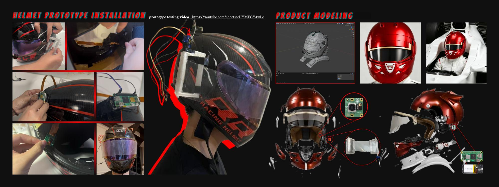
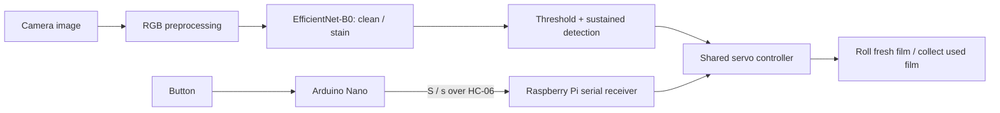

# F1 Visor · Automatic Film Changing Device

**An AI-assisted wearable prototype that connects visual obstruction detection to a motor-driven visor film mechanism.**

[中文说明](README.zh-CN.md) · [Prototype video](https://youtube.com/shorts/cUYMFGY4wLo) · [Hardware](docs/HARDWARE.md) · [Training](docs/TRAINING.md) · [Collection](docs/COLLECTION.md) · [Source history](docs/HISTORY.md)



*Original portfolio documentation: physical prototype on the left, product modelling on the right. Design and prototype by Tan Xiayang / 谈夏洋.*

[Project outline and implementation map](docs/PROJECT_OUTLINE.md) separates implemented prototype behavior from design aspirations and pending hardware evidence.

## Design question

How might a visor respond to dirt or water without requiring a driver to repeatedly reach for a tear-off film? This project explores the question through a camera, an EfficientNet-B0 classifier and a rolling-film mechanism. A separate Arduino Nano button provides a manual Bluetooth trigger.

The repository connects the design proposal to inspectable code: image collection, dataset preparation, model training, evaluation plots, desktop inference, Raspberry Pi deployment and button firmware. It is a research prototype for bench demonstrations, with no claim of race readiness or safety certification.

## System



- **Vision:** whole-image binary classification; it does not locate or segment stains.
- **Automatic action:** the stain probability must stay above the model threshold for 3 seconds by default. A cooldown follows movement.
- **Manual action:** one press sends one byte. The receiver accepts `S` and `s`; motion is shared with the visual path, and overlapping requests are discarded.
- **Reproducibility:** model metadata carries class order, image size, threshold and a SHA-256 digest. Training and inference use the same normalization and padding.

## Start on a computer

Python 3.11 is the recommended baseline. No Raspberry Pi is needed for tests, training or image/video inference.

```bash
python3 -m venv .venv
source .venv/bin/activate
# Windows PowerShell: .venv\Scripts\Activate.ps1
python -m pip install -r requirements.txt
python -m unittest discover -s tests -v
```

The test suite runs a small **synthetic** two-epoch training → export → reload → image inference check without downloading pretrained weights. It also checks timing, actuator cleanup, configuration, dataset duplication and class metadata.

For the complete collector/report test suite, also install `requirements-analysis.txt` and `requirements-collect.txt`; tests requiring those optional dependencies otherwise report a skip.

### Collect image candidates

```bash
python -m pip install -r requirements-collect.txt
python collect_images.py search --query "F1 helmet cam view" --output data/candidates.jsonl
# Review the candidate sources and usage terms, then:
python collect_images.py download --input data/candidates.jsonl --output data/unreviewed
```

Search uses Microsoft Edge and Bing; download also accepts your own JSONL URL list. The collector records provenance, validates formats, deduplicates files and resumes successful downloads. Label images manually before adding them to `clean/` or `stain/`. See [collection details and live-search limits](docs/COLLECTION.md).

### Train and export

Place permitted images in `data/raw/clean/` and `data/raw/stain/`, then:

```bash
python prepare_data.py --source data/raw --output data/split
python train.py --data data/split --output runs/experiment-01
python export_model.py --checkpoint runs/experiment-01/best.pt --output models/visor_fp32.pt
python detect_video.py --model models/visor_fp32.pt --image path/to/test-image.jpg
```

The first standard training run downloads ImageNet initialization. Training uses validation loss to select a checkpoint and validation predictions to choose a threshold; the held-out test set is evaluated afterward. See [data split caveats and experiment review](docs/TRAINING.md).

Generate loss/accuracy curves, PR/ROC, confusion matrices and hard examples from a completed run:

```bash
python -m pip install -r requirements-analysis.txt
python evaluation_plots.py --run runs/experiment-01 --data data/split
```

### Webcam or recorded video

```bash
python -m pip install -r requirements-video.txt
python detect_video.py --camera 0
python detect_video.py --video path/to/demo.mp4 --headless
```

Press `q` to close the desktop preview. Add `--snapshots data/cam_snaps` and press `s` to save an unannotated frame. `--image-dir path/to/images --seed 42` selects a reproducible random image for testing. Output is JSON lines; video output includes measured FPS. These commands never move the servo.

**Model availability:** trained weights and the original dataset are not part of the public source package. Train your own pair, or use a separately supplied, trusted `.pt` + `.json` pair. The author's prepared local folder includes the original FP32 pair, excluded from Git and the upload ZIP. The [model card](docs/MODEL_CARD.md) explains its provisional metadata and why weights are separate.

## Deploy to the prototype

Follow [HARDWARE.md](docs/HARDWARE.md) for Raspberry Pi OS, power, GPIO, calibration, Bluetooth pairing and the service template. After setup:

```bash
cp config.example.json config.local.json
# Adjust config.local.json to your wiring and servo calibration.
python servo_test.py --config config.local.json --run
python detect.py --config config.local.json
```

Upload [`firmware/nano_button/nano_button.ino`](firmware/nano_button/nano_button.ino) with Arduino IDE for a classic Nano. The button → Bluetooth → servo interaction was validated by the project author. The reference firmware is reconstructed from the documented protocol, with debouncing and one command per press.

## Repository map

| Path | Purpose |
| --- | --- |
| `collect_images.py` | Candidate search, bounded downloads, provenance and resume |
| `prepare_data.py` | Image validation, duplicate rejection and seeded split |
| `train.py` | EfficientNet-B0 transfer learning, checkpoint selection and metrics |
| `evaluation_plots.py` | Saved-run evaluation plots, classification report and hard examples |
| `export_model.py` | FP32 TorchScript export, reload check and model metadata |
| `detect_video.py` | Computer-side image, video and webcam testing |
| `detect.py` | Raspberry Pi camera, Bluetooth and servo loop |
| `servo_test.py` | Isolated servo calibration using the same configuration |
| `f1visor/` | Shared preprocessing, configuration, timing and model code |
| `firmware/` | Arduino Nano reference program |
| `notebooks/training.ipynb`, `collection.ipynb` | Step-by-step workflows calling the same CLI implementations |
| `notebooks/experiment.ipynb` | Review actual learning curves and test confusion matrix |
| `deploy/` | Editable systemd service template |
| `tests/`, `.github/workflows/` | Local tests and Python / Arduino CI |

## Evidence and limitations

The [original demonstration video](https://youtube.com/shorts/cUYMFGY4wLo) and portfolio image document the author's physical prototype. The [verification record](docs/VERIFICATION.md) separates that evidence from software checks performed during repository preparation.

Additional source notebooks supplied the original collector and saved historical results, now documented in [Source history](docs/HISTORY.md). The raw dataset, split manifest and per-image historical predictions remain unavailable; the historical scores have not been independently reproduced or linked to the deployed checkpoint. A target recall of `0.98` is a training setting, not a measured result. No Raspberry Pi latency is claimed. Changes in lighting, framing, reflection and rain require further evaluation. The current mechanism has no end-stop, jam or film-exhaustion sensor, and manual triggering still depends on the Pi, Bluetooth and actuator power.

## License and attribution

Original project code and authored documentation are released under [MIT](LICENSE). Portfolio imagery, trained weights, datasets, trademarks and third-party dependencies are not relicensed by the software license; see [NOTICE](NOTICE.md). This is an independent student project and is not affiliated with Formula 1.
