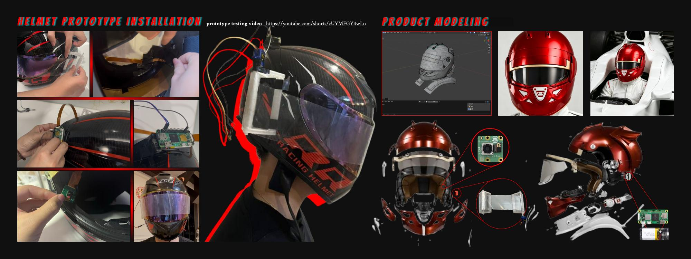

# F1 Visor · 自动卷膜视觉识别装置

**用计算机视觉识别视野遮挡，通过树莓派驱动卷膜装置，并保留 Arduino Nano 蓝牙按钮控制。**

[English](README.md) · [原型演示视频](https://youtube.com/shorts/cUYMFGY4wLo) · [硬件接线与部署](docs/HARDWARE.md) · [训练流程](docs/TRAINING.md)

[项目大纲与实现对照](docs/PROJECT_OUTLINE.md)：逐项说明 PDF 的设计目标、现有代码和仍待实物验证的部分。



*左侧为实物制作与安装，右侧为产品建模。项目作者：谈夏洋。*

## 项目介绍

当水渍、泥点等遮挡头盔视野时，能否让保护膜主动更新，减少手动撕膜操作？本项目将这个设计问题实现为可演示的交互原型：摄像头采集图像，EfficientNet-B0 判断画面为 `clean` 或 `stain`；持续检测达到阈值后，树莓派控制连续旋转舵机卷动保护膜。独立按钮通过 Arduino Nano 和 HC-06 发送手动触发指令。

此仓库展示设计到实现的完整软件链路，用于研究与台架演示，不宣称可直接用于赛车或实际驾驶安全系统。识别器是整张图像的二分类，未实现污渍位置框选、分割或在线自学习。

也可以使用 [训练工作流 Notebook](notebooks/training.ipynb) 与 [采集工作流 Notebook](notebooks/collection.ipynb)，它们调用同一份 Python 实现。

## 快速运行

建议 Python 3.11。在仓库根目录执行：

```bash
python3 -m venv .venv
source .venv/bin/activate
# Windows PowerShell 使用 .venv\Scripts\Activate.ps1
python -m pip install -r requirements.txt
python -m unittest discover -s tests -v
```

测试无需树莓派，包含两轮合成数据训练、导出、重新加载和图片推理。这些数据只用于验证程序流程，不代表真实模型效果。

### 使用本地现有模型

作者本地整理目录的 `models/` 中保留了可加载的原始 FP32 模型与配套 JSON：

```bash
python detect_video.py --image 你的测试图片.jpg
python -m pip install -r requirements-video.txt
python detect_video.py --camera 0
```

公开源码 ZIP 和 Git 默认不包含权重、数据集及个人配置。别人下载源码后，需要按下文训练自己的模型，或另行获得可信的模型与 JSON。不要只复制 `.pt`，类别顺序、输入尺寸和阈值在同名 `.json` 中。

### 重新训练与导出

将有权使用的图片放入 `data/raw/clean/` 与 `data/raw/stain/`：

```bash
python prepare_data.py --source data/raw --output data/split
python train.py --data data/split --output runs/experiment-01
python export_model.py --checkpoint runs/experiment-01/best.pt --output models/new_model.pt
python detect_video.py --model models/new_model.pt --image 你的测试图片.jpg
```

首次正常训练会下载 ImageNet 预训练权重。最佳模型按验证损失选择，阈值只使用验证集，测试集留到最后评估。损坏图片与完全重复图片会明确报错，避免被灰色占位图替代后继续训练。连续视频帧仍需按拍摄场景分组，详见[训练说明](docs/TRAINING.md)。

### 树莓派与 Arduino

先完成[接线、供电、蓝牙配对与舵机校准](docs/HARDWARE.md)，然后：

```bash
cp config.example.json config.local.json
python servo_test.py --config config.local.json --run
python detect.py --config config.local.json
```

默认舵机信号为 BCM13，检测持续时间与动作时间均为 3 秒。舵机停止中位、速度、脉宽必须按实物校准。Arduino 程序位于 `firmware/nano_button/nano_button.ino`，按钮用 D2 接 GND，通过硬件串口发送 `S`；接收端兼容大小写。按钮蓝牙控制链路已由作者验证，参考程序增加消抖和按下一次触发一次的逻辑。

## 图片采集与评估图表

补充提供的 `f1_image_collect.ipynb` 已整理为独立采集工具：

```bash
python -m pip install -r requirements-collect.txt
python collect_images.py search --query "F1 helmet cam view" --output data/candidates.jsonl
# 检查来源与图片使用条件后下载：
python collect_images.py download --input data/candidates.jsonl --output data/unreviewed
```

下载支持来源清单、断点恢复、内容哈希去重和真实图片格式识别。结果需要人工分类再用于训练，详见[采集说明](docs/COLLECTION.md)。

训练完成后生成评估图表与误判样例：

```bash
python -m pip install -r requirements-analysis.txt
python evaluation_plots.py --run runs/experiment-01 --data data/split
```

`detect_video.py --image-dir 图片目录 --seed 42` 可复现随机图片测试；`--camera 0 --snapshots data/cam_snaps` 可按 `s` 保存未叠字的原始帧。安装上述两组依赖后再运行单元测试，会包含完整采集与绘图检查；缺少可选依赖时对应测试会标为跳过。

## 本次源码整理

- 拆出独立训练、数据准备和模型导出入口，保留 EfficientNet-B0 骨干与原分类头结构。
- 清除运行文件中重复拼接的代码；让导入模块不再立即操作硬件。
- 统一预处理与模型元信息；修正树莓派图像通道顺序。
- 合并自动与手动舵机入口，加入互斥、冷却、异常恢复及退出清理。
- 移除个人蓝牙地址与硬编码账户路径，提供配置样例和 systemd 模板。
- 补充中英文 README、模型说明、实验查看 Notebook、MIT 与 GitHub Actions。

新增爬虫已移除网页 `eval()`，三个训练版本的可用逻辑统一到现有入口，旧独立测试文件不再依赖 Notebook 全局变量。原位置文件已更新为统一实现的兼容入口或工作流，修改前内容单独归档；[历史文件说明](docs/HISTORY.md)记录每个文件的去向、修正点和保存的实验成绩。

## 结果与边界

[验证记录](docs/VERIFICATION.md)区分本地软件检查、作者已有原型验证和后续实机回归。新增历史 Notebook 包含实验成绩，但没有原始数据与逐张预测供独立复核。v3 的阈值分类准确率为历史记录中的 93.33%，与 argmax 的 95.56% 含义不同，不能视为当前部署模型的复测结果。历史类别映射支持 `clean=0, stain=1`，但具体权重与实验的对应关系仍不明确；原部署阈值 0.4 是手动设置。

代码使用 [MIT](LICENSE)。图片、模型、数据集和第三方依赖的权利范围见 [NOTICE](NOTICE.md)。上传操作见 [PUBLISH.md](docs/PUBLISH.md)。
